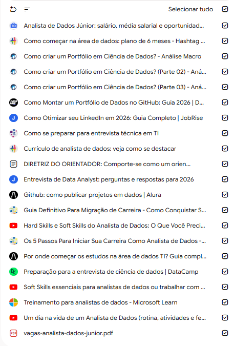
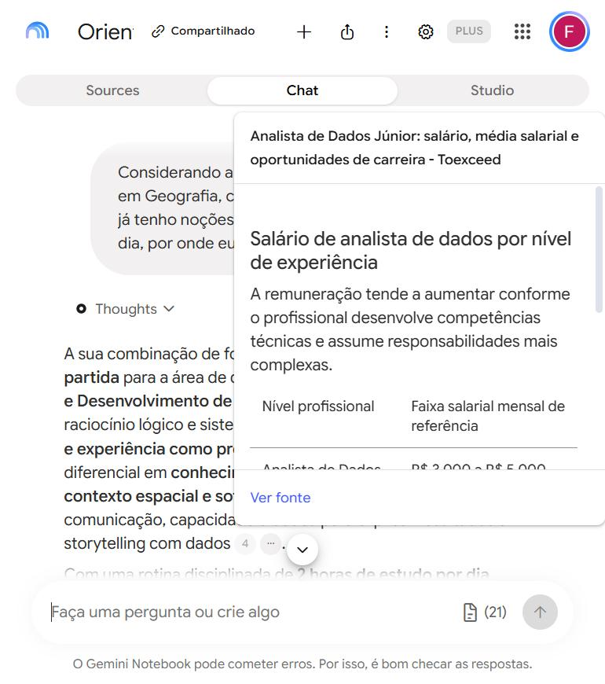
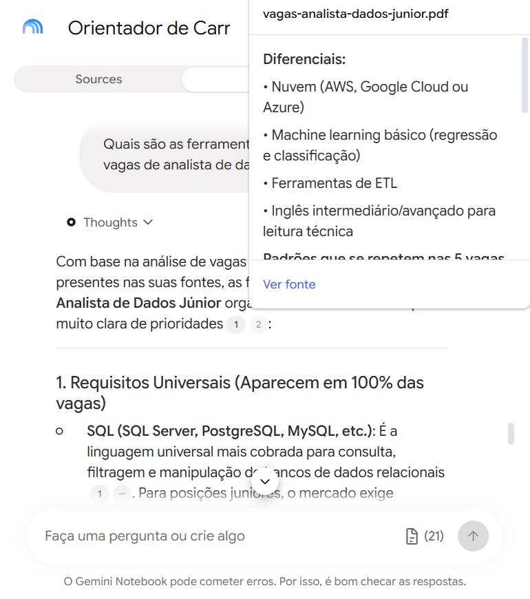
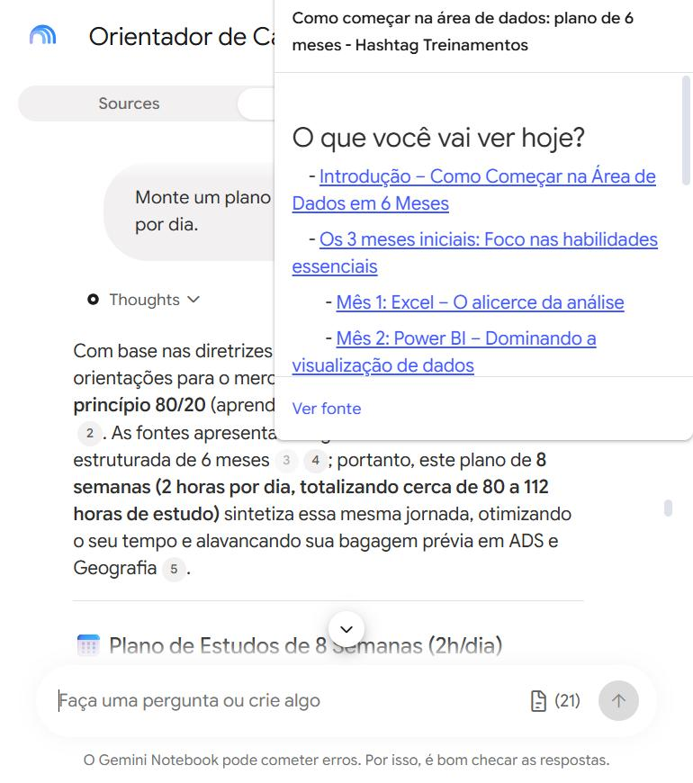
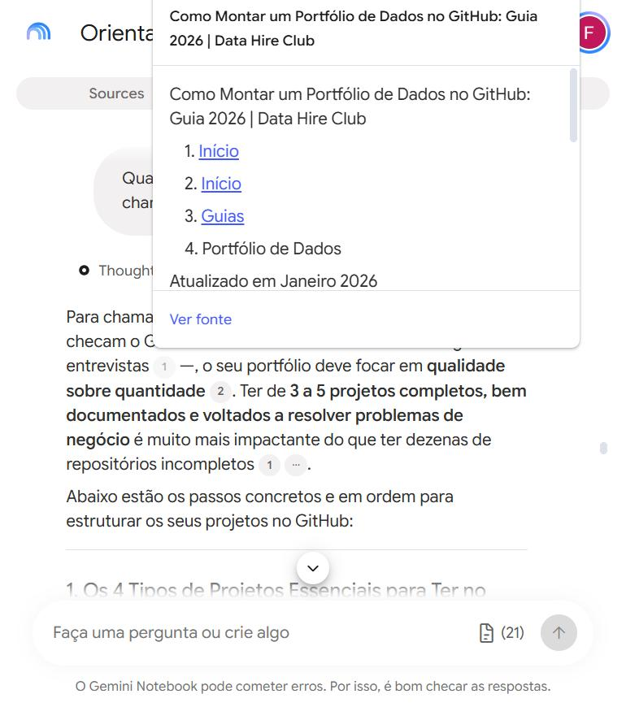
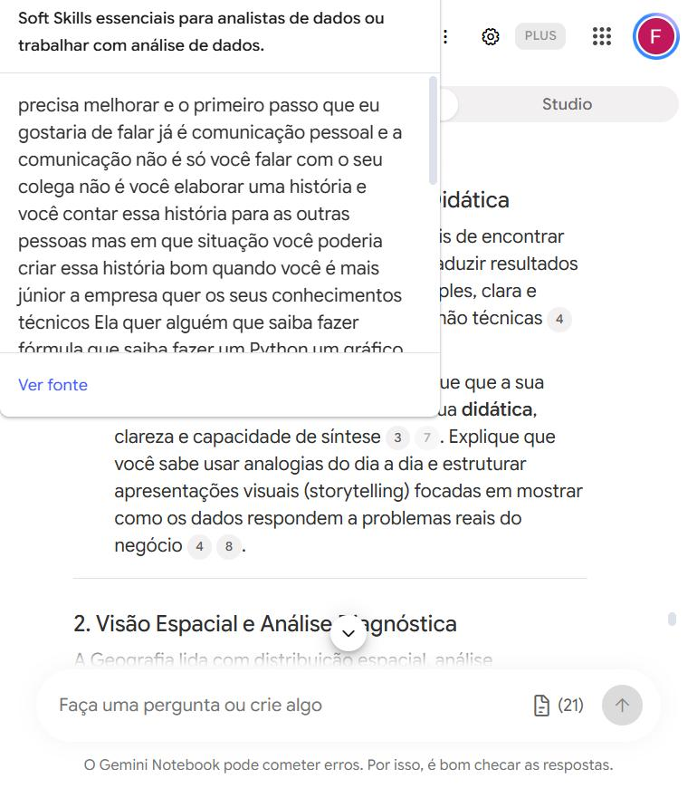

# 🧠 Segundo Cérebro: Orientador de Carreira em Análise de Dados

Projeto do desafio **"Treinando uma IA de Aprendizagem: Explore o Poder do NotebookLM"** da [DIO](https://www.dio.me/).

Montei no **Gemini Notebook** (antigo NotebookLM, do Google) um orientador de carreira que me ajuda a conseguir o **primeiro emprego como analista de dados júnior**. Ele responde **apenas com base nas fontes que eu escolhi** e mostra de onde tirou cada informação.

🔗 **Notebook compartilhado:** [Orientador de Carreira - Analista de Dados Júnior](https://notebook.google.com/notebook/ac3ed425-cde4-4138-89e4-a24dceceb10e)

---

## 🎯 Tema e objetivo

**Tema:** orientador de carreira para conseguir o primeiro emprego como analista de dados júnior.

**Objetivo:** quero um orientador que me diga o que estudar, em que ordem, e como me apresentar para conseguir minha primeira vaga de analista de dados, partindo do zero em experiência na área.

**O que o segundo cérebro precisa saber:**
- O que o mercado busca nos profissionais de entrada (júnior)
- O que um analista de dados júnior faz no dia a dia
- Como me destacar em hard skills e soft skills
- Quais ferramentas as vagas pedem
- Uma ordem de estudo realista para 2 horas por dia
- Como montar um portfólio de projetos no GitHub
- Como adaptar currículo e LinkedIn para a área
- Como me preparar para entrevistas e testes técnicos
- Como usar minha formação anterior (ADS e licenciatura em Geografia) a meu favor

---

## 📚 Fontes e por que confio nelas

Usei **4 critérios** para decidir se uma fonte entrava:
1. O autor trabalha com dados ou é uma escola ou empresa conhecida.
2. É de 2024 para cá.
3. Tem conteúdo de verdade, e não só venda de curso.
4. Fala do mercado brasileiro.

Busquei os vídeos em **aba anônima**, para o algoritmo do YouTube não escolher por mim. O notebook ficou com **20 fontes de conteúdo + 1 fonte com a diretriz**, em 3 formatos: **PDF, vídeo e texto**.

### Fonte própria (PDF)
| Fonte | Por que confio |
|---|---|
| `vagas-analista-dados-junior.pdf` | Resumo de 5 vagas reais publicadas na Gupy (Afya, Banco Daycoval, Benner, Funcional Health Tech e Banco Mercantil), consultadas em 19/10/2026, sem dados pessoais de recrutadores. É o próprio mercado dizendo o que pede, sem intermediário. |

### Vídeos (YouTube)
| Fonte | Por que confio |
|---|---|
| [Um dia na vida de um Analista de Dados](https://www.youtube.com/watch?v=dLVv5T3k5j4) | Canal "Diário de um Analista de Dados", abril de 2026. O autor mostra a própria rotina com as ferramentas reais que usa (SQL, ETL, dashboards). |
| [Hard Skills e Soft Skills do Analista de Dados](https://www.youtube.com/watch?v=DvMtVz4dvZE) | Canal DATA DT, abril de 2026, voltado para quem está em transição de carreira. |
| [Soft Skills essenciais para analistas de dados](https://www.youtube.com/watch?v=0KWR9gHrqOo) | Canal Bruce Fonseca - Dados + IA. É de 2023, mas mantive porque soft skills mudam pouco com o tempo. |

### Textos
| Gaveta | Fonte | Por que confio |
|---|---|---|
| Mercado | [Analista de Dados Júnior: salário e oportunidades (Toexceed)](https://toexceed.com.br/blog/2026/10/14/analista-de-dados-junior-salario-media-salarial-e-oportunidades-de-carreira/) | Outubro de 2026, focado especificamente no nível júnior. |
| Ferramentas | [Os 5 passos para iniciar a carreira (Data Science Academy)](https://blog.dsacademy.com.br/analista-de-dados-por-onde-comecar-em-5_passos/) | Escola brasileira especializada em dados há muitos anos. |
| Ordem de estudo | [Por onde começar os estudos na área de dados (Alura)](https://www.alura.com.br/artigos/por-onde-comecar-estudos-area-dados) | Uma das maiores escolas de tecnologia do Brasil. |
| Portfólio | [Como Montar um Portfólio de Dados no GitHub (Data Hire Club)](https://www.datahireclub.com.br/guias/portfolio-dados-github) | Guia de 2026 específico de portfólio de dados no GitHub. |
| Portfólio | [GitHub: como publicar projetos em dados (Alura)](https://www.alura.com.br/conteudo/github-publicar-projetos-ciencia-dados) | Passo a passo de publicação de projetos. |
| Portfólio | [Como criar um portfólio em Ciência de Dados, partes 1](https://analisemacro.com.br/data-science/como-criar-um-portfolio-em-ciencia-de-dados/), [2](https://analisemacro.com.br/data-science/como-criar-um-portfolio-em-ciencia-de-dados-parte-02/) e [3](https://analisemacro.com.br/data-science/como-criar-um-portfolio-em-ciencia-de-dados-parte-03/) (Análise Macro) | Série em 3 partes. Na primeira versão da lista estava por engano na gaveta de currículo e eu corrigi. |
| Currículo | [Currículo de analista de dados (Hashtag Treinamentos)](https://www.hashtagtreinamentos.com/curriculo-analista-de-dados) | Escola brasileira conhecida, com modelos de currículo para júnior. |
| LinkedIn | [Como Otimizar seu LinkedIn em 2026 (JobRise)](https://jobrise.io/pt/blog/como-otimizar-linkedin-2026-guia-completo/) | 2026, com exemplos de título e "Sobre" específicos para analista de dados. |
| Entrevista | [Entrevista de Data Analyst: perguntas e respostas para 2026 (JobRise)](https://jobrise.io/pt/blog/entrevista-data-analyst-perguntas-respostas-2026/) | 2026, focado em analista de dados no Brasil. Entrou no lugar de um artigo sobre IA e Ciência de Dados, que mirava cargos acima do júnior. |
| Entrevista | [Preparação para a entrevista de ciência de dados (DataCamp)](https://www.datacamp.com/pt/blog/data-science-interview-preparation) | Plataforma internacional de ensino de dados. |
| Entrevista | [Como se preparar para entrevista técnica (Serasa Experian)](https://www.serasaexperian.com.br/carreiras/blog-carreiras/como-se-preparar-para-entrevista-tecnica/) | Blog de carreiras de uma empresa que contrata profissionais de dados. |
| Transição | [Guia Definitivo Para Migração de Carreira (Data Science Academy)](https://blog.dsacademy.com.br/guia-definitivo-para-migracao-de-carreira-como-conquistar-seu-lugar-na-area-de-dados-parte-1/) | Guia específico de migração de carreira para dados. |

### Fontes do Deep Research
Na busca, pedi só 4 fontes que seguissem os meus 4 critérios. **O Deep Research trouxe 17.** Conferi as novas uma a uma:

| Fonte | Decisão | Motivo |
|---|---|---|
| [Treinamento para analistas de dados (Microsoft Learn)](https://learn.microsoft.com/pt-br/training/roles/data-analyst) | ✅ Mantida | Conteúdo oficial e gratuito da Microsoft, fabricante do Power BI, ferramenta pedida em todas as vagas do PDF. |
| [Como começar na área de dados: plano de 6 meses (Hashtag Treinamentos)](https://www.hashtagtreinamentos.com/como-comecar-na-area-de-dados-power-bi) | ✅ Mantida | Publicada em nov/2025 e atualizada em jul/2026, com plano mês a mês de Excel, Power BI, SQL, projetos e candidaturas. |
| Entre as Ciências Sociais e a Ciência de Dados (Medium) | ❌ Removida | Publicada em 2021 e sem informar a profissão da autora. Falhou nos critérios 1 e 2. |
| De pesquisador acadêmico a analista de dados (EBAC) | ❌ Removida | Publicada em 2023 e é um depoimento usado para vender curso, com preço e cupom no meio do texto. Falhou nos critérios 2 e 3. |

> **Aprendizado:** o Deep Research ajuda a achar fontes, mas não segue os critérios à risca. Quem decide o que entra sou eu.



---

## 🧭 Diretriz de comportamento

```
Comporte-se como um orientador de carreira especialista em Análise de Dados, que me acompanha na busca do primeiro emprego como analista de dados júnior. Sou formado em ADS, fui professor de Geografia e estudo 2 horas por dia. Responda só com base nas fontes, citando de onde veio cada informação. Seja direto e prático: dê passos concretos e em ordem. Quando as fontes não cobrirem algo, diga isso claramente.
```

**Como apliquei:** primeiro coloquei o texto no campo de resumo personalizado do notebook, mas percebi que esse campo não muda o comportamento do chat. Então adicionei a diretriz **como uma fonte de texto** ("DIRETRIZ DO ORIENTADOR"). O teste mostrou que funcionou: o notebook passou a se apresentar como orientador de carreira e a levar em conta a minha formação.

---

## 💬 Perguntas, respostas e fontes

### 1. "Considerando a minha formação (ADS e licenciatura em Geografia, com experiência como professor), que já tenho noções de Python e que estudo 2 horas por dia, por onde eu começo?"
**Resposta:** um plano de 6 meses: Excel (mês 1), Power BI (mês 2), SQL (mês 3), portfólio no GitHub com dados abertos ligados à Geografia (mês 4), LinkedIn e currículo destacando a experiência como professor (mês 5) e candidaturas (mês 6). Tratou Python como diferencial. **Avisou que as fontes não detalham como dividir as 2 horas diárias**, como a diretriz pede.

**Fontes citadas:** plano de 6 meses (Hashtag) · PDF de vagas · Toexceed · Data Hire Club · Currículo (Hashtag) · LinkedIn (JobRise) · Serasa Experian



### 2. "Quais são as ferramentas que mais aparecem nas vagas de analista de dados júnior?"
**Resposta:** em todas as vagas aparecem SQL e Power BI. Na maioria, Excel (tabela dinâmica, PROCV/PROCX) e Power Query. Como diferenciais, Python, Git/GitHub e nuvem (BigQuery, Snowflake, dbt).

**Fontes citadas:** **PDF de vagas** · Toexceed · plano de 6 meses (Hashtag)



### 3. "Monte um plano de estudos de 8 semanas com 2 horas por dia."
**Resposta:** adaptou o plano de 6 meses para 8 semanas. Semanas 1 e 2: Excel e Power Query. Semanas 3 e 4: Power BI e DAX. Semanas 5 e 6: SQL. Semana 7: projetos no GitHub. Semana 8: LinkedIn, currículo e entrevistas. Deixou claro que é uma adaptação, porque as fontes trazem um plano de 6 meses.

**Fontes citadas:** plano de 6 meses (Hashtag) · Data Science Academy · Alura · PDF de vagas · Data Hire Club · JobRise · Serasa Experian · vídeo de Hard e Soft Skills, entre outras



### 4. "Quais projetos devo colocar no meu GitHub para chamar a atenção dos recrutadores?"
**Resposta:** de 3 a 5 projetos completos (análise exploratória em Python, dashboard em Power BI, análise com SQL e um projeto que integre ferramentas), usando dados do IBGE e do dados.gov.br para aproveitar a bagagem em Geografia. Também trouxe um modelo de README e erros a evitar.

**Fontes citadas:** Data Hire Club · plano de 6 meses (Hashtag) · Data Science Academy · JobRise · Currículo (Hashtag)



### 5. "Como posso usar minha experiência como professor de Geografia a meu favor na entrevista?"
**Resposta:** comunicação e didática para explicar dados a quem não é técnico; conhecimento de domínio; pensar em voz alta nos testes técnicos; e respostas comportamentais no formato STAR, com um exemplo da sala de aula.

**Fontes citadas:** Guia de Migração de Carreira (DSA) · vídeo de Soft Skills (Bruce Fonseca) · Serasa Experian · JobRise · Os 5 Passos (DSA)

> **Senso crítico:** a ligação entre Geografia e "visão espacial" parece ter sido feita pelo próprio notebook, a partir do que as fontes dizem sobre conhecimento de domínio. Antes de usar esse argumento, confiro as citações.



O registro completo das perguntas está em [`perguntas-e-respostas.md`](perguntas-e-respostas.md).

---

## 🎨 Materiais gerados no Estúdio

| Material | Arquivo |
|---|---|
| Mapa mental (5 ramos: plano de estudos, portfólio, currículo e LinkedIn, entrevistas, transição de carreira) | [`mapa-mental.png`](mapa-mental.png) |
| Apresentação de slides "Transição para Análise de Dados" | [`slides.pdf`](slides.pdf) |
| Guia de estudos com quiz, gabarito, perguntas dissertativas e glossário | [`guia-de-estudos.md`](guia-de-estudos.md) |


---

## 📁 Estrutura do repositório

```
segundo-cerebro-dados/
├── README.md
├── perguntas-e-respostas.md
├── guia-de-estudos.md
├── mapa-mental.png
├── slides.pdf
├── vagas-analista-dados-junior.pdf
├── projeto-notebook-dados.txt
└── prints/
    ├── fontes.png
    ├── pergunta-01.png
    ├── pergunta-02.png
    ├── pergunta-03.png
    ├── pergunta-04.png
    ├── pergunta-05.png
    └── mapa-mental-visao-geral.png
```

---

## 💡 O que aprendi

- **Poucas fontes bem escolhidas valem mais que muitas.** Criar critérios antes de buscar facilitou cada decisão.
- **Montar uma fonte própria (o PDF de vagas reais)** deu ao orientador uma visão direta do mercado, e ela foi a fonte mais citada sobre ferramentas.
- **A IA precisa de conferência:** o Deep Research trouxe fontes fora dos critérios, e o notebook às vezes faz ligações por conta própria. Clicar nas citações é o que garante que a resposta veio das fontes.
- **Uma diretriz bem escrita muda o comportamento:** pedir para avisar quando as fontes não cobrem algo fez o notebook ser honesto sobre os próprios limites.
